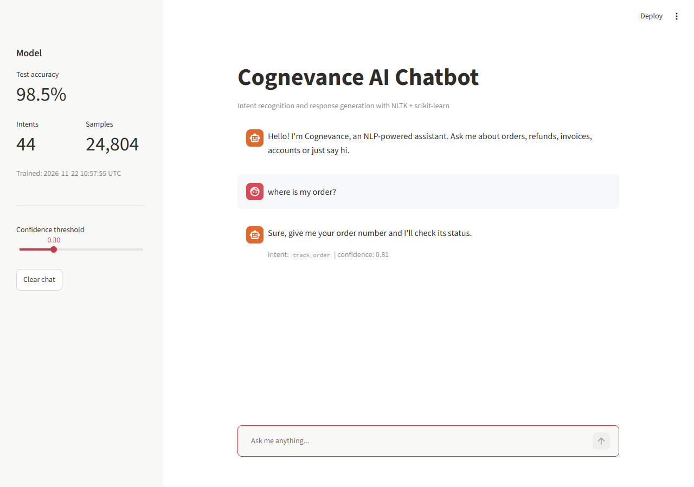

# Cognevance AI Chatbot

An intermediate-level NLP chatbot that recognizes user intent and generates a
response, built with **NLTK**, **scikit-learn** and **Streamlit**.



## Overview

Cognevance classifies a user message into one of **44 intents** (orders,
refunds, invoices, payments, accounts, shipping, greetings, jokes and more) and
replies with a curated response. It is a complete, reproducible project:
dataset preparation, NLP preprocessing, model training, evaluation, CLI, web UI,
tests and documentation.

## Features

- **44 intents** trained on **24,804 labeled patterns**
- **NLP preprocessing with NLTK**: contraction expansion, tokenization,
  stopword filtering that preserves intent-bearing words, POS-aware WordNet
  lemmatization
- **TF-IDF (unigrams + bigrams) + Logistic Regression** classifier with
  balanced class weights
- **Confidence-based fallback** when the intent is unclear
- **Response generation** from per-intent response pools, including a dynamic
  time response
- **Streamlit chat UI** with confidence display and adjustable threshold
- **CLI mode**, evaluation script, confusion matrix and pytest suite

## Results

| Metric | Value |
| --- | --- |
| Held-out test accuracy | **98.47%** |
| Macro precision / recall / F1 | 0.893 / 0.881 / 0.875 |
| Weighted precision / recall / F1 | 0.986 / 0.985 / 0.985 |
| Intents | 44 |
| Training patterns | 24,804 |
| Train / test split | 19,843 / 4,961 |

Full report: [`docs/classification_report.txt`](docs/classification_report.txt)
Confusion matrix: [`docs/confusion_matrix.png`](docs/confusion_matrix.png)

## Dataset

The training data combines two Kaggle datasets plus a small curated seed set:

| Source | Intents | Patterns | Content |
| --- | --- | --- | --- |
| [Bitext Gen AI Chatbot Customer Support Dataset](https://www.kaggle.com/datasets/bitext/bitext-gen-ai-chatbot-customer-support-dataset) | 27 | 24,635 unique | Customer-support Q&A pairs |
| [Chatbots: Intent Recognition Dataset](https://www.kaggle.com/datasets/elvinagammed/chatbots-intent-recognition-dataset) | 16 | 104 | Greetings, jokes, thanks, goodbyes |
| Curated seed phrases | 1 new + additions | 65 | Common queries + `capabilities` intent |
| **Total** | **44** | **24,804** | |

`scripts/prepare_dataset.py` merges both raw files into
[`data/intents.json`](data/intents.json) using the standard
`{tag, patterns, responses}` schema. Raw files are kept in `data/raw/`.
See the Kaggle pages for dataset license terms.

## Project structure

```
.
├── app/
│   ├── __init__.py
│   └── streamlit_app.py        # Streamlit chat interface
├── data/
│   ├── raw/                    # Original Kaggle datasets
│   └── intents.json            # Unified training dataset (generated)
├── docs/
│   ├── classification_report.txt
│   ├── confusion_matrix.png
│   ├── demo.md                 # Demo transcript
│   ├── streamlit_chat.png
│   └── streamlit_ui.png
├── models/                     # Trained artifacts (generated, gitignored)
├── scripts/
│   ├── __init__.py
│   ├── capture_screenshots.py  # Playwright screenshot generator
│   └── prepare_dataset.py      # Dataset merge + curation
├── src/
│   ├── __init__.py
│   ├── chatbot.py              # Inference + response generation
│   ├── config.py               # Paths and constants
│   ├── evaluate.py             # Held-out evaluation
│   ├── preprocess.py           # NLTK preprocessing pipeline
│   └── train.py                # Model training + artifacts
├── tests/
│   ├── __init__.py
│   └── test_chatbot.py
├── main.py                     # CLI chat
├── requirements.txt
├── requirements-dev.txt
└── README.md
```

## Setup

Requires Python 3.10+ (developed on Python 3.12).

### Windows (PowerShell)

```powershell
python -m venv .venv
.\.venv\Scripts\Activate.ps1
python -m pip install -r requirements.txt
```

### macOS / Linux

```bash
python3 -m venv .venv
source .venv/bin/activate
python -m pip install -r requirements.txt
```

NLTK corpora (`punkt`, `stopwords`, `wordnet`, POS tagger) are downloaded
automatically on first use.

## Usage

### 1. Prepare the dataset

```powershell
python -m scripts.prepare_dataset
```

### 2. Train the model

```powershell
python -m src.train
```

Artifacts are written to `models/` (`intent_pipeline.joblib`,
`metadata.json`). The confusion matrix and classification report are written to
`docs/`.

### 3. Evaluate

```powershell
python -m src.evaluate
```

### 4. Chat in the terminal

```powershell
python main.py
```

### 5. Run the web UI

```powershell
python -m streamlit run app/streamlit_app.py
```

Open <http://localhost:8501>. The sidebar shows model accuracy, dataset size
and a confidence-threshold slider.

### 6. Run tests

```powershell
python -m pytest -q
```

### 7. Regenerate screenshots (optional)

```powershell
python -m pip install -r requirements-dev.txt
python -m scripts.capture_screenshots
```

Uses Playwright with the locally installed Microsoft Edge; no browser download
is required.

## How it works

```
raw Kaggle data
      │
      ▼
scripts/prepare_dataset.py  ──►  data/intents.json
      │
      ▼
src/preprocess.py (NLTK)
  • remove placeholders, URLs, punctuation
  • expand contractions ("can't" → "cannot")
  • tokenize
  • remove stopwords, but keep wh-words, negations and possessives
  • POS-aware lemmatization
      │
      ▼
src/train.py
  • TF-IDF (1–2 grams, sublinear TF)
  • Logistic Regression (class_weight="balanced")
  • stratified 80/20 split
      │
      ▼
models/intent_pipeline.joblib + metadata.json
      │
      ▼
src/chatbot.py
  • preprocess input
  • predict intent + confidence
  • fallback if confidence < 0.30
  • pick a response for the intent
```

Response pools are stored in `models/metadata.json`. The `time_query` intent
returns the current local time dynamically; other intents select a random
response from their curated pool.

## Example conversation

| User message | Predicted intent | Confidence |
| --- | --- | --- |
| `hello there` | `greeting` | 0.95 |
| `how are you?` | `courtesy_greeting` | 1.00 |
| `what is your name?` | `name_query` | 1.00 |
| `where is my order?` | `track_order` | 0.82 |
| `I want a refund` | `get_refund` | 0.86 |
| `I can't log in` | `recover_password` | 0.41 |
| `what can you do?` | `capabilities` | 1.00 |
| `bye` | `goodbye` | 0.98 |
| `zxqv blorf quux` | fallback | 0.05 |

See [`docs/demo.md`](docs/demo.md) for the full demo transcript.

## Deliverables checklist

- [x] Chatbot source code (`src/`, `app/`, `main.py`)
- [x] Training dataset (`data/intents.json` + `data/raw/`)
- [x] NLP preprocessing scripts (`src/preprocess.py`,
      `scripts/prepare_dataset.py`)
- [x] Screenshots / demo (`docs/`)
- [x] Project documentation (`README.md`, `docs/demo.md`)
- [x] GitHub repository link:
      <https://github.com/mohdadnan001/cognevance_aiChatBot>

### Repository

<https://github.com/mohdadnan001/cognevance_aiChatBot>

## Limitations and future work

- Intent recognition is closed-domain: unseen topics fall back instead of
  generating free-form answers.
- Merged datasets create class imbalance; balanced class weights mitigate this.
- Responses are curated templates rather than generative output.
- Possible extensions: spaCy NER for entities, conversation context tracking,
  a FastAPI backend, Docker packaging and more intents.

## Acknowledgments

- [Bitext](https://www.kaggle.com/datasets/bitext/bitext-gen-ai-chatbot-customer-support-dataset)
  for the customer-support dataset
- [elvinagammed](https://www.kaggle.com/datasets/elvinagammed/chatbots-intent-recognition-dataset)
  for the conversational intents dataset
- NLTK, scikit-learn and Streamlit maintainers
