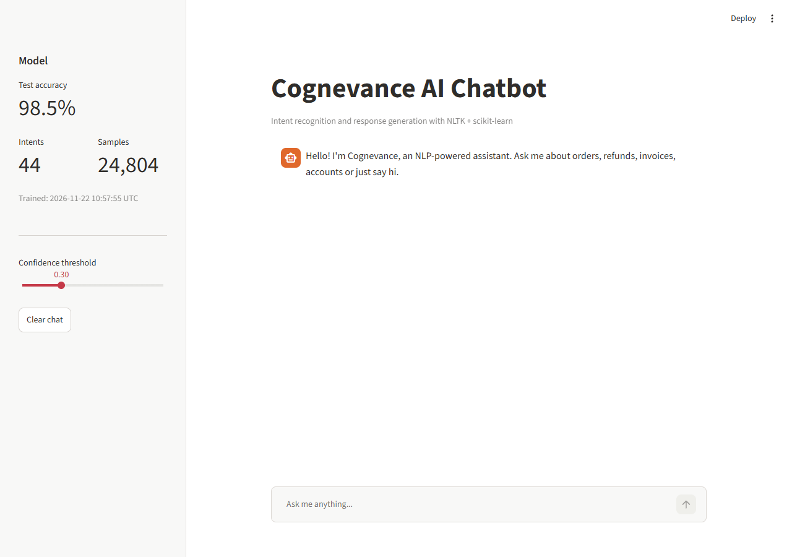
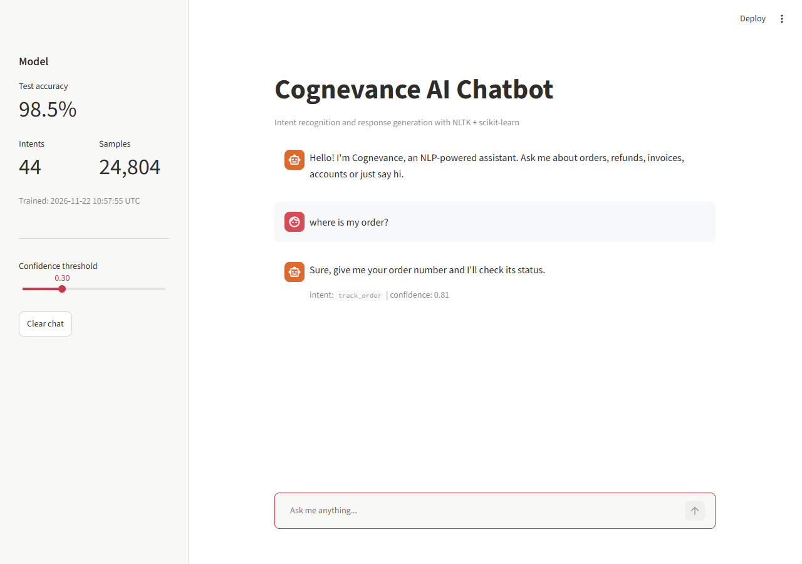

# Demo

## Streamlit interface





The sidebar shows the held-out test accuracy (98.5%), the number of intents and
training samples, and a confidence-threshold slider. Each bot reply displays the
predicted intent and confidence.

## Command-line transcript

```
============================================================
Cognevance AI Chatbot
Intents: 44 | Test accuracy: 98.5%
Type 'quit', 'exit' or 'bye' to stop.
============================================================

You: hi
Bot (greeting, 0.95): Hi there! What can I do for you?

You: where is my order?
Bot (track_order, 0.81): I can track your order. Please share your order number.

You: I want a refund
Bot (get_refund, 0.86): Sure, let's start your refund. What's the order number?

You: I can't log in
Bot (recover_password, 0.41): I can help you recover your password. Please provide the email linked to your account.

You: what can you do?
Bot (capabilities, 1.00): I can help with orders, refunds, invoices, payments, accounts, shipping and general chat. Try asking 'where is my order?' or 'I want a refund'.

You: zxqv blorf quux
Bot (fallback, 0.05): I'm not sure I understood that. Could you rephrase your question?

You: bye
Bot: Goodbye! Have a great day.
```

## Sample intent predictions

| User message | Intent | Confidence |
| --- | --- | --- |
| `hello there` | `greeting` | 0.950 |
| `how are you?` | `courtesy_greeting` | 1.000 |
| `what is your name?` | `name_query` | 0.998 |
| `who are you` | `name_query` | 0.996 |
| `thanks` | `thanks` | 0.986 |
| `tell me a joke` | `jokes` | 0.999 |
| `see you later` | `goodbye` | 1.000 |
| `where is my order?` | `track_order` | 0.815 |
| `I want a refund` | `get_refund` | 0.858 |
| `cancel my order` | `cancel_order` | 0.585 |
| `I can't log in` | `recover_password` | 0.413 |
| `forgot my password` | `recover_password` | 0.947 |
| `change my address` | `change_shipping_address` | 1.000 |
| `asdfghjkl` | fallback | 0.052 |

## Reproducing the screenshots

```powershell
python -m pip install -r requirements-dev.txt
python -m scripts.capture_screenshots
```

The script starts Streamlit, opens it with Playwright using the installed
Microsoft Edge, captures the landing page, sends "where is my order?" and
captures the conversation.
